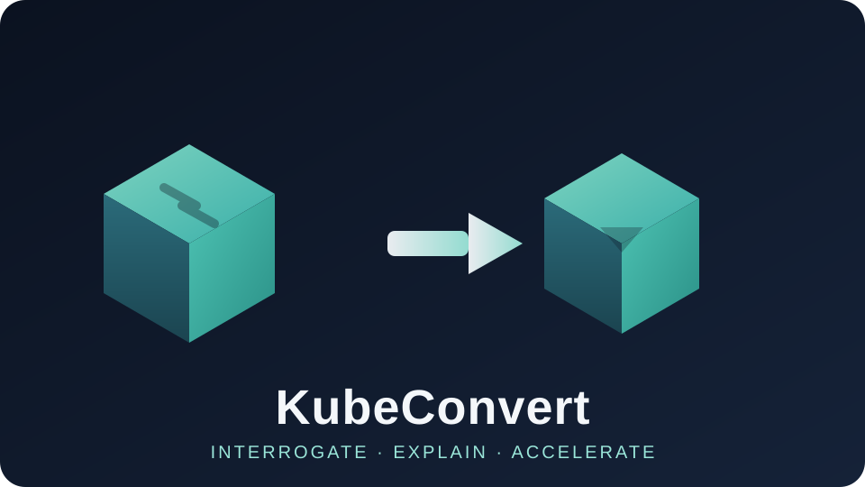
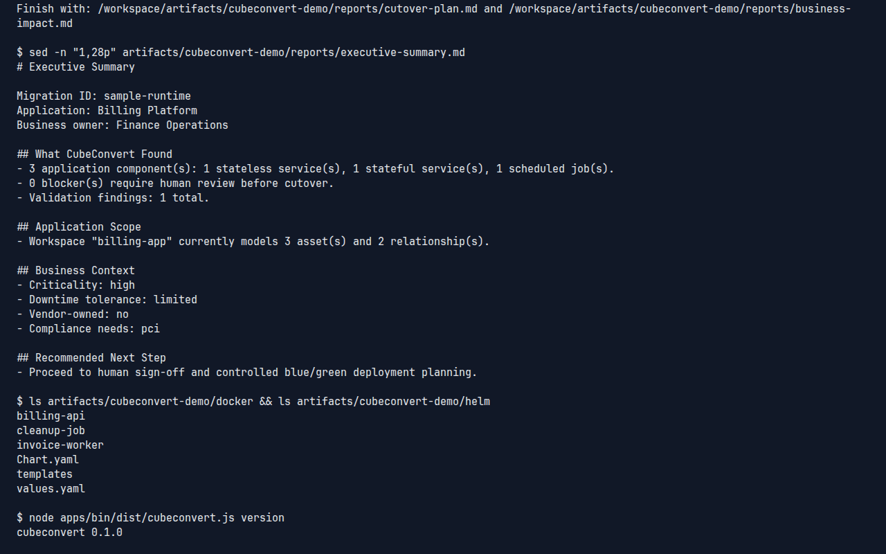

<p align="center">
  
</p>

<p align="center">
  <a href="https://github.com/fairley46/stratosphere/actions/workflows/ci.yml"></a>
  <a href="LICENSE"></a>
</p>

# KubeConvert

**Interrogate. Explain. Accelerate.**

KubeConvert is a Kubernetes-first migration architect for legacy enterprise applications.
It observes how a VM actually behaves, explains what it found in plain language, and produces
a governed migration package engineers can review and deploy safely.

This project was formerly Stratosphere.




Full recording: [docs/assets/kubeconvert-demo.mp4](docs/assets/kubeconvert-demo.mp4) (~29s).

---

## Why it exists

Enterprise VMs accumulate years of undocumented runtime behavior. Hand modernization means
stale wikis, interviews, and high-risk guesswork. KubeConvert captures live runtime evidence,
decomposes it into deployable workloads, and emits a complete Kubernetes migration package
with review and approval gates before anything changes.

It is not click-to-migrate. v1 produces artifacts and an execution plan that platform teams
deploy after sign-off.

---

## Quickstart (fresh clone)

Requires Node.js 22+.

```bash
git clone https://github.com/fairley46/stratosphere.git
cd stratosphere
npm install
npm run build
npm run test
```


Generate a full migration package from the committed billing fixture:

```bash
npm run demo
```

Output lands in `artifacts/kubeconvert-demo/`. Start with
`reports/executive-summary.md`, then the current and future application maps.

Equivalent explicit command:

```bash
npm run kubeconvert -- \
  --runtime-file fixtures/kubeconvert/sample-runtime.json \
  --strategy balanced \
  --intake-file fixtures/kubeconvert/sample-intake.json \
  --workspace-file fixtures/kubeconvert/sample-workspace.json \
  --signoff-required-approvers 2 \
  --export-provider github \
  --export-owner acme-enterprise \
  --export-repo billing-modernization \
  --out-dir artifacts/my-migration
```

Single-binary install for SSH-first VMs: see
[On-Box Quickstart](docs/kubeconvert/engineering/ON_BOX_QUICKSTART.md)
and [GitHub Releases](https://github.com/fairley46/stratosphere/releases).

---

## What you get

| Artifact | Description |
|---|---|
| `Dockerfile` per workload | Minimal, layered, ready to build |
| `helm/` chart | Values, templates, secrets scaffold |
| `terraform/` scaffold | Namespace, RBAC, storage provisioning |
| `reports/migration-summary.md` | Plain-language overview |
| `reports/executive-summary.md` | Decision-ready brief for app owners |
| `reports/readiness.{json,md}` | Readiness score, blockers, confidence |
| `reports/business-impact.{json,md}` | Customer, security, and effort translation |
| `reports/cutover-plan.{json,md}` | Blue/green stages and rollback triggers |
| `reports/secrets-management.md` | Detected secrets and injection guide |
| `reports/roi-estimate.{json,md}` | Cost and sustainment ROI model |
| `reports/application-map-*.md` | Current and future architecture maps |

---

## Architecture

```text
[kubeconvert binary]
  |       \
  |        \-- [doctor]
  v
[CLI]                       [MCP Server (stdio)]
  |                                 |
  +--------------+------------------+
                 v
          [@kubeconvert/engine]
                 |
                 | discovery -> decompose -> artifacts + reports
                 v
      [Bundle: docker/ helm/ terraform/ reports/]
```

- `apps/bin`: single executable wrapper (`kubeconvert`, `kubeconvert mcp`, `kubeconvert doctor`)
- `apps/cli`: non-interactive CLI and prompt-driven `--wizard`
- `apps/mcp`: stdio MCP server for agent hosts
- `packages/engine`: deterministic migration engine used by CLI and MCP

Details: [Technical Architecture](docs/kubeconvert/engineering/TECHNICAL_ARCHITECTURE.md).

---

## Ways to use it

1. **MCP** — `npm run mcp:start` (or `kubeconvert mcp`) and drive the workflow from an agent host.
2. **CLI wizard** — `kubeconvert --wizard --runtime-file …` for plain-language prompts in the terminal.
3. **CLI** — `kubeconvert --help` for snapshot files, local discovery, or live SSH.

---

## Status

v0.1.0 ships CLI + MCP, snapshot/local/SSH discovery, governed migration bundles, and
planning-only blue/green cutover artifacts.

Not in this version: Web UI, HTTP API, direct cluster deploy, or full-screen TUI.

Roadmap: [Backlog](docs/kubeconvert/product/BACKLOG.md).

---

## Documentation

**Engineers**
- [Quickstart](docs/kubeconvert/engineering/QUICKSTART.md)
- [On-Box Quickstart](docs/kubeconvert/engineering/ON_BOX_QUICKSTART.md)
- [Engineer Onboarding](docs/kubeconvert/engineering/ENGINEER_ONBOARDING.md)
- [Technical Architecture](docs/kubeconvert/engineering/TECHNICAL_ARCHITECTURE.md)
- [Demo Runbook](docs/kubeconvert/engineering/DEMO_RUNBOOK.md)

**Stakeholders**
- [Product Overview](docs/kubeconvert/product/PRODUCT_OVERVIEW.md)
- [Pilot Execution Plan](docs/kubeconvert/product/PILOT_EXECUTION_PLAN.md)
- [Backlog](docs/kubeconvert/product/BACKLOG.md)

**Governance**
- [Execution Workflow Spec](docs/kubeconvert/governance/EXECUTION_WORKFLOW_SPEC.md)
- [Enterprise Readiness](docs/kubeconvert/governance/ENTERPRISE_READINESS.md)
- [Security Review](docs/kubeconvert/governance/SECURITY_REVIEW.md)

---

## License

MIT. See [LICENSE](LICENSE).

---

*Interrogate. Explain. Accelerate.*
